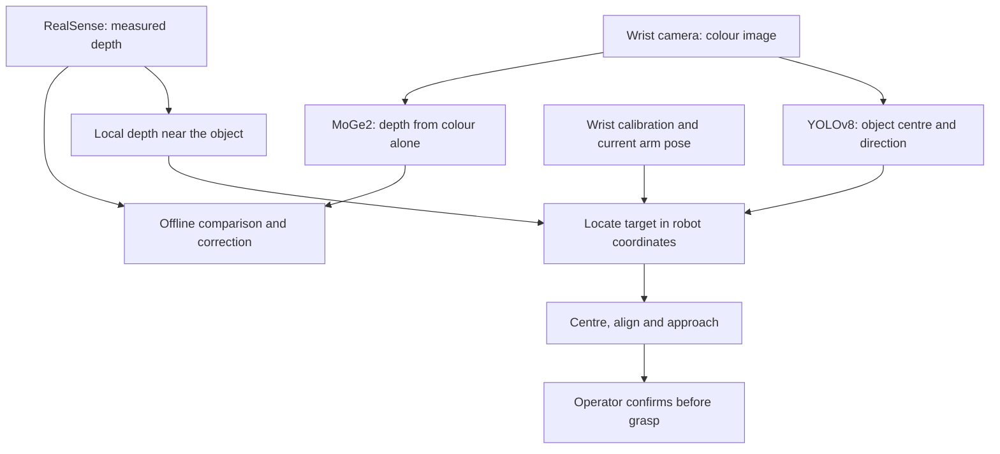

# Vision-Guided Robotic Bin Picking

**Alfred Rojo · FEMTO-ST research internship · 2026**

A robot can recognise an object in an image and still miss it with the gripper. At FEMTO-ST, I worked on closing that gap: detecting an object from a wrist-mounted camera, locating it in the robot's workspace, and turning that measurement into a grasp.

The long-term application was sorting recyclables. The research question was more specific: **could depth inferred from a single colour image eventually replace the depth sensor during a pick?** We built a fixed-object prototype on a six-axis arm and used a whiteboard marker as a controlled target. The physical trials used measured RealSense depth; a separate experiment tested how well an RGB-only model could estimate those distances.

[Prototype](#the-prototype) · [Calibration](#camera-to-robot-calibration) · [Object detection](#finding-the-object) · [Depth experiment](#depth-from-one-image) · [Grasp planning](#from-detection-to-motion) · [Results and next steps](#results-and-next-steps)

## The prototype

 <em>From a fixed-object lab trial: the arm approaches, closes around the marker and lifts it. This silent excerpt shows one trial, not a measured success rate.</em>

The **Niryo Ned2** carries an **Intel RealSense D435** beside its parallel gripper. Mounting the camera on the wrist lets the arm look around for a target and then take a closer measurement. A **Jetson Orin** runs camera acquisition and GPU inference, while the Python controller turns the vision output into robot commands. Bringing up CUDA on the Jetson made it practical to test the vision and motion together on the bench.

*The lab setup with the camera beside the gripper and the checkerboard on the work surface.*

| Camera mount in CAD | First bracket installed |
| :---: | :---: |
|  |  |
| The custom PLA bracket was designed in Fusion 360 and 3D-printed. | The first bracket held the camera near the jaws. A later offset aligned the RGB lens more closely with the gripper centreline. |

## Camera-to-robot calibration

When the arm moves, the same object appears at a different pixel and from a different angle. The robot therefore needs to know exactly how the camera sits relative to its wrist. We photographed a fixed, printed checkerboard from different arm positions, pairing each image with the corresponding robot pose. OpenCV found the corners and estimated where the board was relative to the camera. Combining those observations with the robot's joint positions gave us the camera-to-wrist transform.

| Fabricated target | Corner extraction from a wrist-camera image |
| :---: | :---: |
|  |  |
| Known square spacing gives the images a metric reference. | The detected corners let us estimate the target pose from each view. |

We compared five hand–eye calibration methods on **12 retained pose pairs**. Tsai was selected, with a mean 3D consistency error of **24.26 mm** on those poses. Park and Horaud gave similar results. This check measured how consistently the geometry located a reference point; it did not measure arm repeatability or grasp accuracy. The captured poses covered much more distance along one horizontal axis than the other, so a more varied calibration set is a clear next improvement.

## Finding the object

A bounding box tells the robot roughly where to look. To decide how to turn the jaws, it also needs the shape and direction of the object. We labelled marker outlines in Roboflow and fine-tuned a **YOLOv8 segmentation** model on the Jetson. The outline gave us a centre and a dominant axis for grasp alignment. When the first dataset export produced empty validation labels, we corrected the export and checked the labels before evaluating the model.

*Training and validation on the controlled marker class. The report records approximately 0.95 mask mAP at a 50% overlap threshold. This measures how well the model outlines markers in validation images, not how often the robot picks them up.*

## Depth from one image

The second part of the project asked whether the camera could provide enough geometry without its depth stream. We ran **MoGe2** on RGB images, aligned the RealSense depth to those same images, and compared the two values at matching pixels. Across **12 acquisition runs**, the SQLite database held **4,559,119 paired pixel measurements**. Keeping acquisition settings and sample records separately let us trace errors back to a frame or robot pose and rerun the analysis without repeating the capture.

*An aligned RealSense depth map used to check the acquisition pipeline. Black areas show missing depth. RealSense was the comparison reference, not an error-free ground truth.*

MoGe2 captured the broad shape of the scene, but individual predictions could be noisy. A single correction across all distances was not dependable, so we looked more closely at the arm's working range and grouped predictions by distance. We used the **median signed error** in each range to estimate a correction, then tested how much smoothing and how large a correction to allow. Grouping by the model's **predicted** depth meant the resulting correction could be applied without consulting RealSense at runtime.

*Exploratory plot below 1 m. The median lines follow the reference more closely than the means in some ranges, where large outliers pull the averages away. This plot illustrates why we used medians; the table below reports the final selected correction configuration.*

| Depth error against RealSense | Raw MoGe2 | With correction |
| --- | ---: | ---: |
| Median absolute error | 6.85 cm | **5.95 cm** |
| Mean absolute error | 15.36 cm | **14.84 cm** |
| 90th-percentile absolute error | 28.87 cm | **28.54 cm** |

The typical error improved by **0.90 cm**, but the larger errors changed very little. That was the result that mattered for picking: a useful improvement in the benchmark was not enough to trust the distance at the jaws. The physical trials therefore kept RealSense as the live depth input.

## From detection to motion

The controller combined the target pixel with the median of nearby valid depth readings. The camera calibration and current arm pose then expressed that target relative to the robot base. This meant each sideways correction was a **physical distance**, rather than a joint movement guessed from the pixel offset.

1. **Find and centre.** Sweep the base until the marker is detected, then move the wrist over it while keeping the gripper level. An earlier approach tilted the wrist to centre the image and could lose the object up close. Separating centring from descent kept the target in view.
2. **Align and approach.** Use the object's long axis to turn the jaws, taking the shorter equivalent rotation. Check whether the object fits the gripper and select the closest reachable top-down orientation before lowering the arm.
3. **Confirm, grasp and lift.** Stop for operator confirmation near the target before closing the jaws. The controller then lifts and commands the drop motion. The excerpt above shows the approach, grasp and lift portion of a physical trial.

| Live vision view | 3D planning preview |
| :---: | :---: |
|  |  |
| The overlay exposes the detection, measured depth and estimated grasp target. | The preview shows the planned approach and target before motion. These views are separate captures, not two frames from the same trial. |

## Getting the arm back on the bench

Partway through testing, the controller stopped receiving telemetry from Joint 5 while the other joints still reported normally. Swapping connections helped isolate the fault to the wrist actuator. The replacement had different factory communication settings, so we configured it separately with a U2D2 adapter and Dynamixel Wizard, reinstalled it, checked that the controller could see it, and recalibrated its zero position before resuming trials.

 <em>The diagnostic panel showed missing readings for Joint 5 while neighbouring joints continued to report.</em>

## Results and next steps

The project brought together a custom camera mount, camera-to-robot calibration, marker segmentation, and measured-depth motion control on a physical arm. The controlled trial shows the arm picking up an isolated marker. The depth experiment explains why the prototype still used a sensor for that move: correcting the model helped typical estimates, but occasional larger errors remained.

The next test would compare measured and predicted depth **at the actual grasp point** on new acquisition runs, then log localisation, pickup and placement results across repeated trials. From there, the system could be tested with different recyclable objects, partial occlusion and clutter, where recognising the item and choosing a destination bin become part of the same task.

---

*Based on the FEMTO-ST internship report and original lab figures and footage. This repository contains the public showcase only; project code, datasets and model weights are not included.*
