# Vision-Guided Robotic Bin Picking

**Alfred Rojo · FEMTO-ST research internship · 2026**

**How well can a single colour camera estimate the depth a robot needs to grasp an object?** At FEMTO-ST, I worked on this question in the context of robotic sorting for recycling. A depth map can capture the overall shape of a scene, but the practical test is how accurately it places the object where the gripper needs to close.

We built a wrist-camera picking prototype on a six-axis robot and used a whiteboard marker as the test object. RealSense supplied measured depth for the physical grasps and gave us a reference for evaluating **MoGe2**, which estimates depth from a single RGB image. Across 12 acquisition runs, we collected **4.56 million paired pixel measurements**. A distance-based correction brought median error from **6.85 cm to 5.95 cm**.

[Single-camera depth study](#how-well-did-single-camera-depth-perform) · [Prototype](#the-prototype) · [Calibration](#camera-to-robot-calibration) · [Object detection](#finding-the-object) · [Grasp planning](#from-detection-to-motion) · [Results and next steps](#results-and-next-steps)

## The prototype

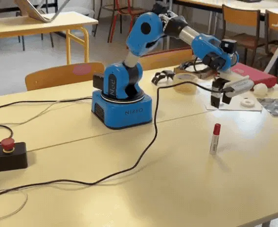 <em>Lab demonstration: the Niryo Ned2 approaches the marker, closes its gripper and lifts the object off the table.</em>

The **Niryo Ned2** carries an **Intel RealSense D435** beside its parallel gripper. Mounting the camera on the wrist lets the arm look around for a target and then take a closer measurement. A **Jetson Orin** runs camera acquisition and GPU inference, while the Python controller turns the vision output into robot commands. Bringing up CUDA on the Jetson made it practical to test the vision and motion together on the bench.

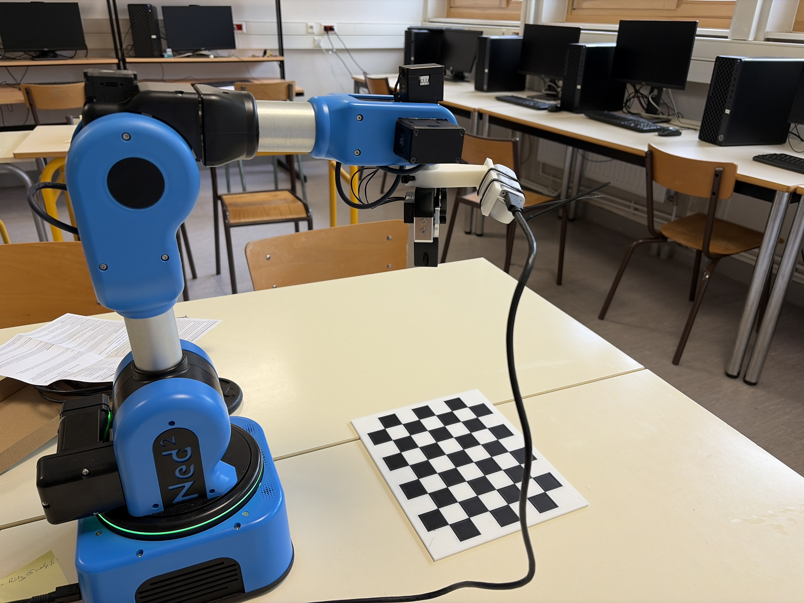
*The lab setup with the camera beside the gripper and the checkerboard on the work surface.*

| Camera mount in CAD | First bracket installed |
| :---: | :---: |
| 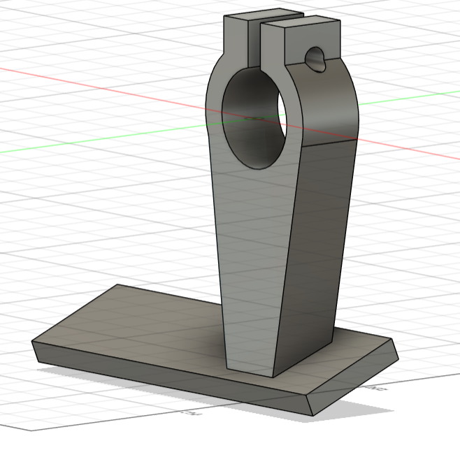 | 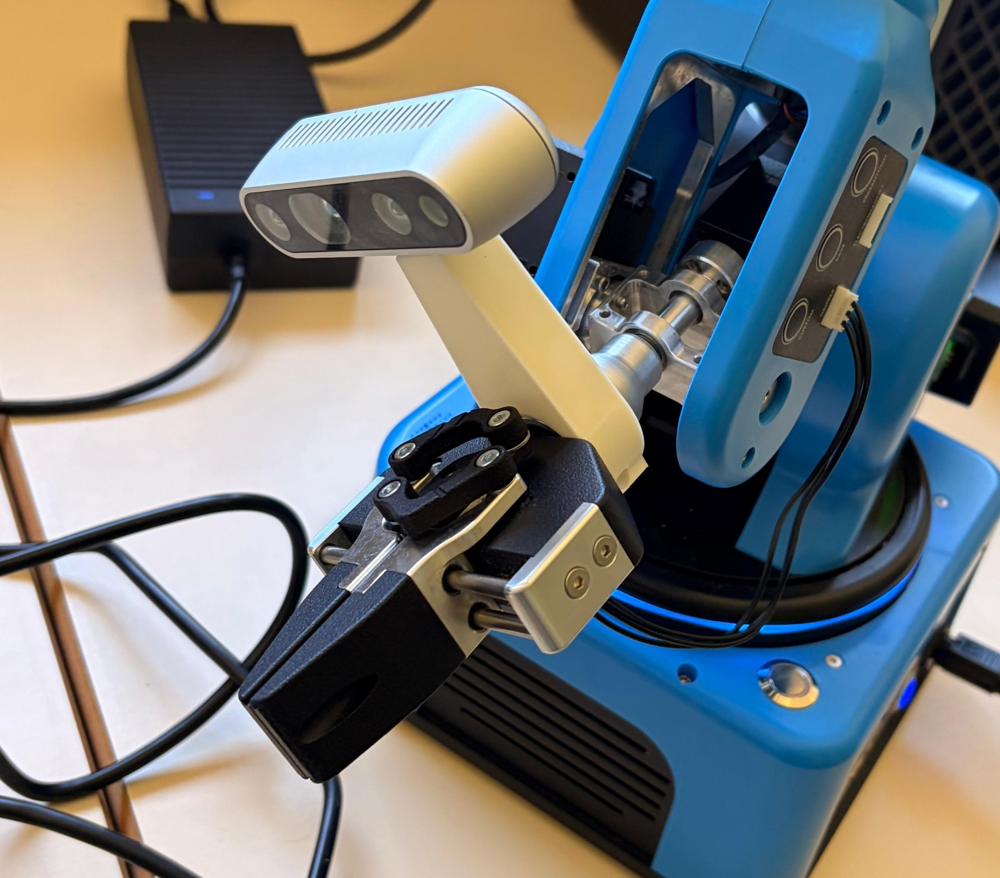 |
| The custom PLA bracket was designed in Fusion 360 and 3D-printed. | The first bracket held the camera near the jaws. A later offset aligned the RGB lens more closely with the gripper centreline. |

## Camera-to-robot calibration

When the arm moves, the same object appears at a different pixel and from a different angle. The robot therefore needs to know exactly how the camera sits relative to its wrist. We photographed a fixed, printed checkerboard from different arm positions, pairing each image with the corresponding robot pose. OpenCV found the corners and estimated where the board was relative to the camera. Combining those observations with the robot's joint positions gave us the camera-to-wrist transform.

| Fabricated target | Corner extraction from a wrist-camera image |
| :---: | :---: |
| 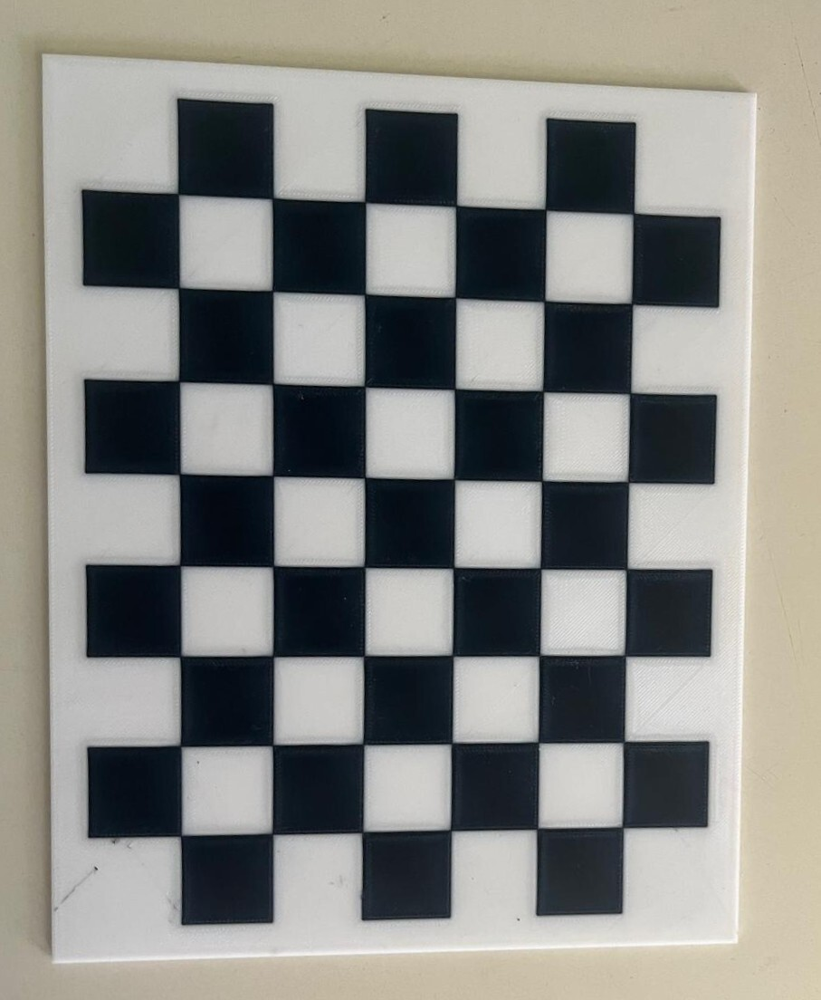 | 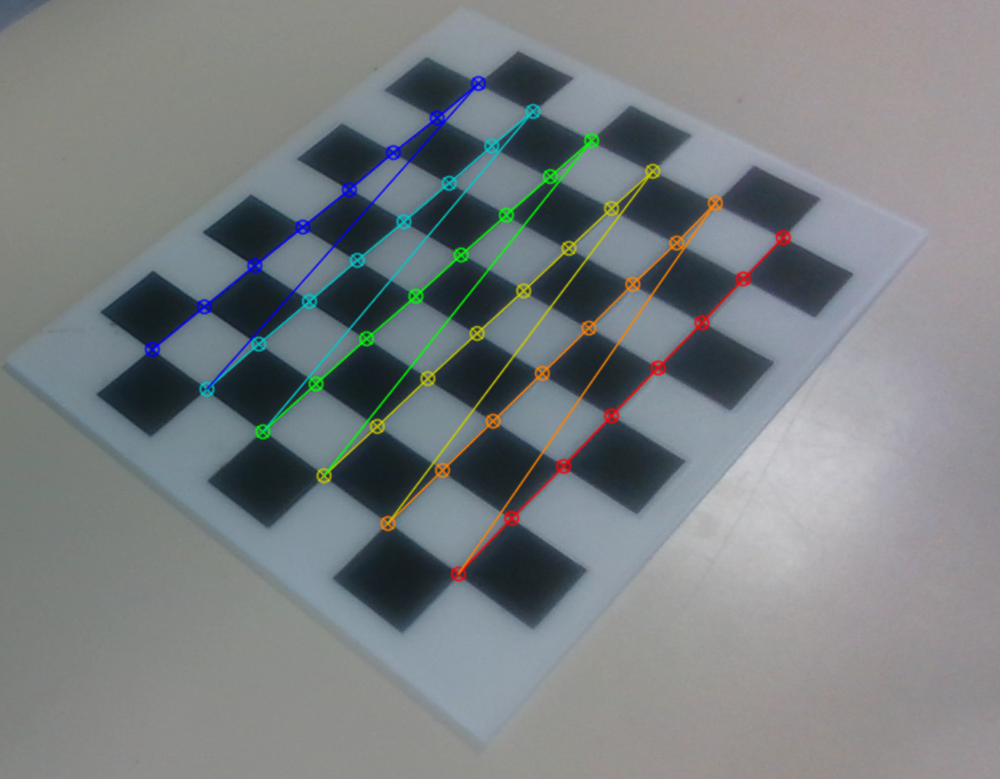 |
| Known square spacing gives the images a metric reference. | The detected corners let us estimate the target pose from each view. |

We compared five hand–eye calibration methods on **12 pose pairs**. The selected Tsai method gave a **24.26 mm mean 3D consistency error** when locating the reference point across those poses. Park and Horaud gave similar results.

## Finding the object

The marker's outline gave the robot two useful cues: a centre to move towards and a long axis to align the jaws. We annotated the outlines in Roboflow, verified the dataset labels and fine-tuned a **YOLOv8 segmentation** model on the Jetson.

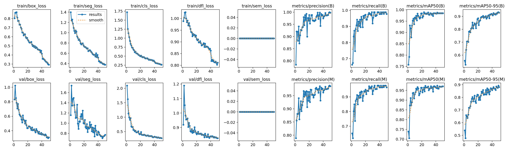
*YOLOv8 training and validation over 50 epochs. On the marker validation set, segmentation reached approximately **0.95 mask mAP@50**.*

## How well did single-camera depth perform?

To assess whether a colour camera could eventually take over the depth sensor's role, we ran **MoGe2** on RGB images collected with the robot. We aligned the RealSense depth to those images and compared the two values at matching pixels. The SQLite database held **4,559,119 paired pixel measurements**. Keeping acquisition settings and sample records separately let us trace errors back to a frame or robot pose and rerun the analysis without repeating the capture.

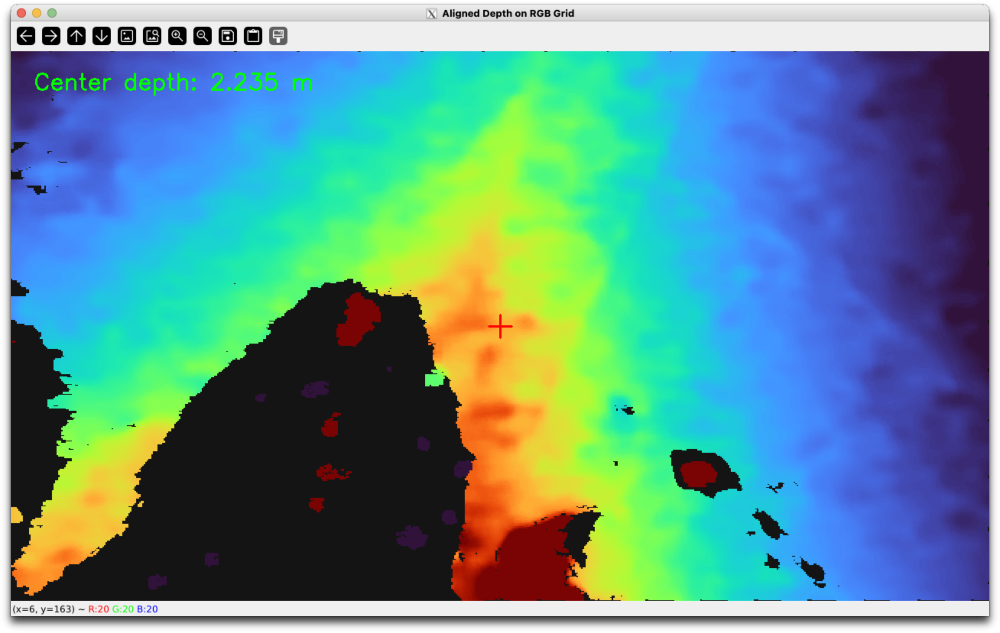
*RealSense depth aligned to the colour image so both methods could be compared at matching pixels.*

MoGe2 captured the broad shape of the scene. To refine its estimates in the arm's working range, we grouped predictions by distance and used the **median signed error** to calculate a correction for each group. We tested different smoothing settings and capped the adjustment. Because the groups are defined by the model's **predicted** depth, the correction can run on the model output alone.

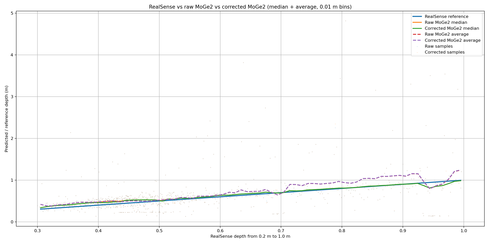
*Exploratory plot below 1 m. The median lines follow the reference more closely than the means in some ranges, where large outliers pull the averages away. This plot illustrates why we used medians; the table below reports the final selected correction configuration.*

| Depth error against RealSense | Raw MoGe2 | With correction |
| --- | ---: | ---: |
| Median absolute error | 6.85 cm | **5.95 cm** |
| Mean absolute error | 15.36 cm | **14.84 cm** |
| 90th-percentile absolute error | 28.87 cm | **28.54 cm** |

The correction reduced median error by **0.90 cm**, while the 90th-percentile error stayed close to **29 cm**. For a robot, both figures matter: the median shows the improvement on a typical pixel, and the 90th percentile shows how large an error can be near the upper end. The next step is to test depth at the grasp point itself, where a small patch of the image determines how far the jaws descend.

## From detection to motion

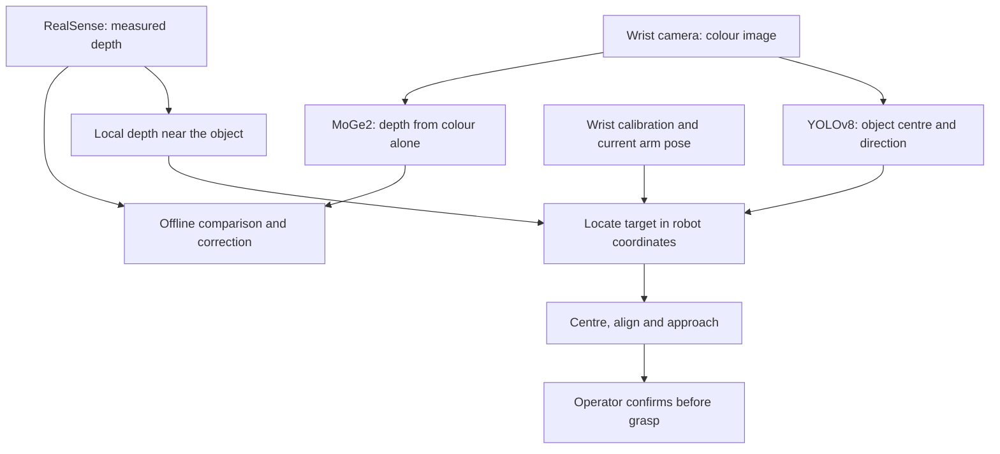

The controller combined the target pixel with the median of nearby valid depth readings. It used the camera calibration and current arm pose to locate the target relative to the robot base, then calculated how far to move the gripper sideways in physical units.

1. **Find and centre.** Sweep the base to find the marker, then move the wrist over it with the gripper level. Separating centring from descent keeps the target in view during alignment.
2. **Align and approach.** Use the object's long axis to turn the jaws, taking the shorter equivalent rotation. Check whether the object fits the gripper and select the closest reachable top-down orientation before lowering the arm.
3. **Confirm, grasp and lift.** Stop for operator confirmation near the target before closing the jaws. The controller then lifts and commands the drop motion. The excerpt above shows the approach, grasp and lift portion of a physical trial.

| Live vision view | 3D planning preview |
| :---: | :---: |
| 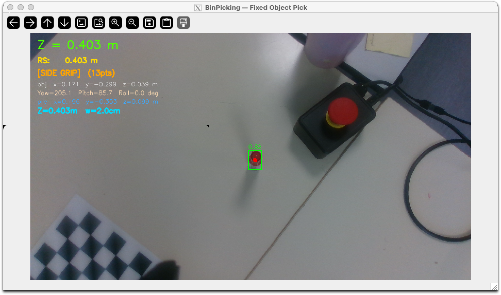 | 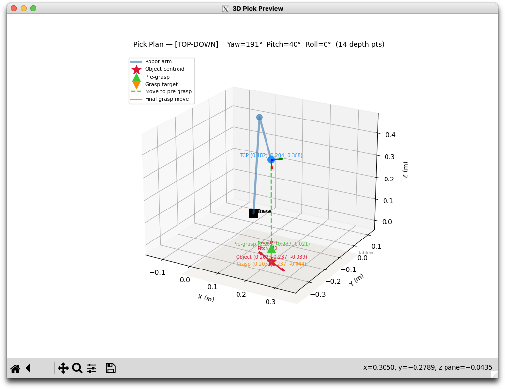 |
| The live overlay shows the detection, measured depth and estimated grasp target. | The planning preview plots the approach and grasp positions in 3D. |

## Getting the arm back on the bench

Partway through testing, the controller stopped receiving telemetry from Joint 5 while the other joints still reported normally. Swapping connections helped isolate the fault to the wrist actuator. The replacement had different factory communication settings, so we configured it separately with a U2D2 adapter and Dynamixel Wizard, reinstalled it, checked that the controller could see it, and recalibrated its zero position before resuming trials.

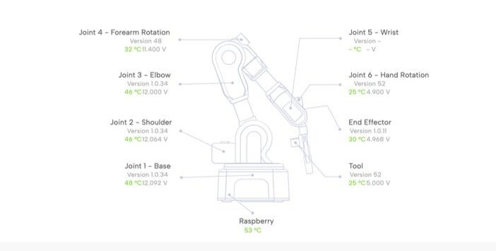 <em>The diagnostic panel showed missing readings for Joint 5 while neighbouring joints continued to report.</em>

## Results and next steps

The physical trial demonstrated the vision-to-grasp workflow with measured RealSense depth. The single-camera study showed how closely RGB-only depth matched that reference on the robot's workspace data and where the correction helped. Together, they give us a working platform and a measured baseline for testing a colour-camera-only pick.

The next steps are to compare measured and predicted depth **at the grasp point**, record pickup and placement results across repeated trials, and extend the pipeline to mixed recyclables. In that setting, the same vision system would help the robot decide both how to grasp an object and which bin to place it in.

---

*Based on the FEMTO-ST internship report, with original lab figures and footage.*
