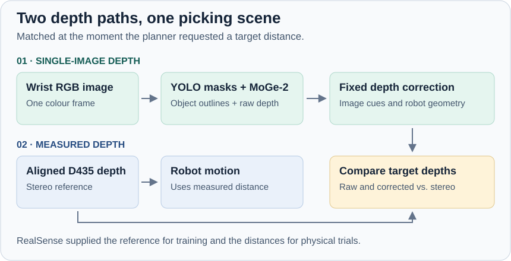
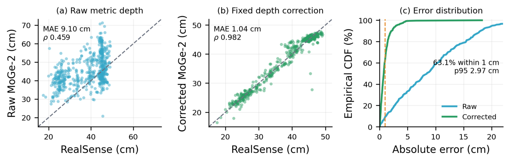
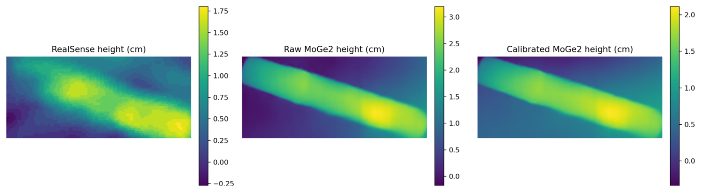
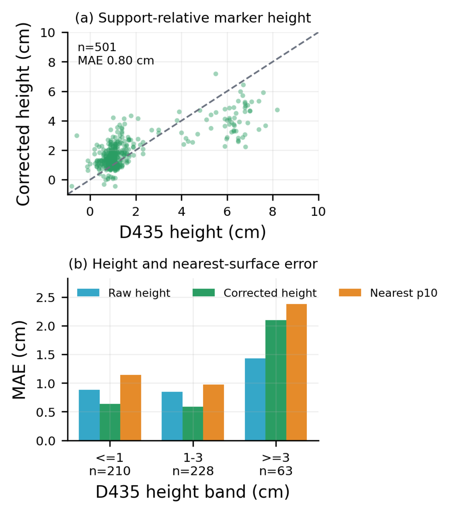
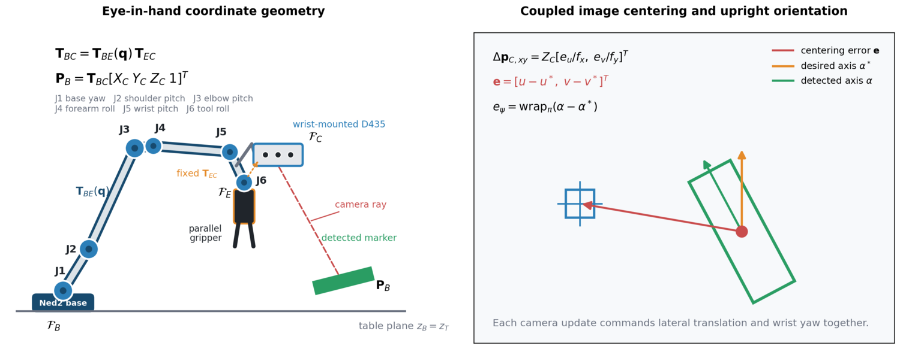
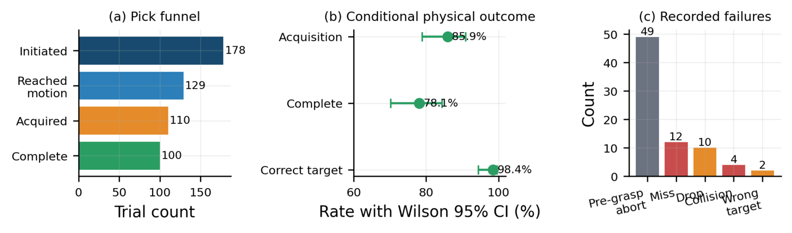

# Vision-Guided Robotic Bin Picking

**Alfred Rojo · FEMTO-ST research internship · Besançon, France · 2026**

**Can a single colour image tell a robot how far away its next pick is?** A small object close to the camera can look the same size as a larger one farther away. The robot needs that distance to know how far to lower its gripper.

[MoGe-2](https://arxiv.org/abs/2507.02546), introduced in 2025, estimates depth in real-world units from a single image. We ran it on images from the robot’s wrist camera and compared its estimates with RealSense measurements as the robot picked markers. Across **223 requests for a target distance**, a correction fitted on earlier data reduced the mean absolute depth error from **9.82 cm to 1.10 cm**.

The project was motivated by the selective sorting of returned diabetes devices for recycling. Whiteboard markers gave us repeatable, pen-shaped test objects for studying how a robot handles elongated items in clutter. The physical trials used measured RealSense depth; the monocular estimates were evaluated alongside it on the same views.

[The setup](#a-camera-on-the-wrist) · [Depth experiment](#from-one-image-to-a-distance) · [Results](#how-close-did-single-image-depth-get) · [Robot demonstration](#from-target-selection-to-placement)

  
   <em>The wrist-mounted camera moves with the gripper, so the robot can inspect an object again as it approaches.</em>

## A camera on the wrist

The six-axis **Niryo Ned2** carried an **Intel RealSense D435** beside a parallel gripper on a custom 3D-printed PLA bracket. Its colour stream supplied the input for both vision models. Its aligned stereo depth served two purposes: measuring distance for the physical trials and providing a reference against which to evaluate the single-image estimates. An **NVIDIA Jetson Orin** ran acquisition and model inference, while the Python controller used the detections and measured distances to plan motion.

| Designing the mount | Calibrating the view |
| :---: | :---: |
|  |  |
| The bracket fixes the camera beside the jaws so their relative position stays constant as the wrist moves. | Images of a fixed checkerboard from different wrist poses connect what the camera sees to where the robot can move. |

Camera calibration tells us which direction a pixel points in; **hand–eye calibration** places that direction in the robot's coordinate system. We compared five hand–eye solvers on 12 pose pairs and selected Tsai–Lenz, which had the lowest mean transform-chain consistency residual (24.26 mm). That residual measures agreement across calibration poses, and is a separate source of uncertainty from the depth error reported below.

## From one image to a distance

**YOLOv8n-seg** traces each marker's outline, giving the controller a centre to move towards and a long axis to align the jaws with. We fine-tuned it on a custom marker dataset and obtained approximately **0.95 mAP@0.5** for boxes and masks on its validation subset. **MoGe-2 ViT-L** takes the same colour image and estimates distance at every pixel. The system runs it once per image, then reads the relevant part of that map for each detected marker.

Raw depth shifted with distance and viewpoint as the wrist moved. We fitted an **18-feature ridge regression** on earlier recordings to adjust MoGe-2's estimates using image position, marker size and shape, local depth context and known camera and robot height. RealSense supplied the training reference. Applying the fitted correction takes the RGB-derived measurements and robot geometry as inputs; the neural network weights and the correction coefficients stayed fixed throughout the three later evaluation sessions.

To compare the two depth paths fairly, the logger paired the **same colour image** with aligned RealSense depth, the recorded robot pose and the controller stage. It also recorded when the planner asked for the selected marker's distance. This let us judge the model on the views a working robot actually encountered, including close alignment, where the target often looks different from the initial observation.

## How close did single-image depth get?

For each detected marker, we compared the median depth inside its mask with the RealSense median for the corresponding region. The table reports the **mean absolute difference** across those comparisons, in centimetres. Across three later sessions, the system recorded 505 paired images and 834 marker regions; the main comparison retained 556 regions from 339 images after checks on sensor coverage, timing, pose and grasp phase.

| Evaluation | Error before → after correction |
| --- | --- |
| All eligible marker regions (556) | 9.10 → **1.04 cm** |
| Selected targets at planner requests (223) | 9.82 → **1.10 cm** |

*Final evaluation. The diagonal marks agreement with RealSense. The corrected estimates cluster closer to it, and the steeper green curve shows how many more estimates fall within small error margins.*

The main comparison showed an **88.6% reduction** in mean absolute error, with **89.0% of regions within 2 cm**. Resampling whole camera images, so markers in the same image stayed together, gave a 95% confidence interval of **0.94–1.14 cm** for the corrected mean absolute error. Close alignment was a useful stress test: error fell from **13.06 cm to 1.04 cm** across 158 regions observed at that stage.

### The part that matters to the gripper

A marker can sit flat, lean against another object or rest on top of a pile. Its median depth tells the robot roughly where it is. For the last part of a descent, the gripper also needs to know how far the marker protrudes above what surrounds it and where it will first meet the object.

*A development example of the marker's relief above its support. Each panel has its own colour scale in centimetres.*

  
   <em>Final evaluation. Corrected height had a mean absolute error of 0.80 cm across 501 eligible regions. In the lower plot, the nearest-surface estimate reached 2.38 cm mean absolute error for objects at least 3 cm above their support.</em>

The corrected median-depth error was below 2.97 cm for roughly 95% of evaluated regions, with a largest observed error of 18.27 cm. MoGe-2 inference took a median of 791 ms. Those two measurements point to practical checks for a future RGB-guided descent: whether a prediction is current enough to use, and whether the uncertainty still leaves enough room for the jaws.

## From target selection to placement

The controller ranks exposed markers by their measured depth and keeps track of the selected marker as the wrist changes viewpoint. As the arm approaches, each new observation updates both lateral position and wrist rotation. This keeps the gripper centred while bringing its jaws into line with the marker.

*The red point is the detected marker centre; the blue square is the desired image position. The arm moves the point towards the square while rotating the gripper into alignment.*

The arm first moves to a standoff of about **15 cm**, then rechecks the target near **8 cm**. Once the centre is within tolerance, it holds its lateral position and yaw while descending, closes the gripper, lifts the marker, checks that it was acquired and moves it to the drop location.

  
   <em>Early fixed-marker bench demonstration: approach, grasp and lift with RealSense-guided distance. The final clutter-trial results are reported below.</em>

### RealSense-guided physical trials

*The trial counts show how many attempts reached motion, acquired a marker and completed placement. Outcome rates in the centre panel use the 128 motion trials with a recorded label.*

Of **178 initiated trials**, 49 stopped before the grasp and 129 reached motion. Among the **128 labelled motion trials**, the robot acquired 110 markers and completed **100 pick-and-place cycles (78.1%)**. That was **56.2%** of all initiated trials. Correct target identity was maintained in **98.4%** of labelled motion trials, and median cycle time was **44.4 seconds** for trials reaching motion.

## What this establishes

On this lab setup, single-image depth with a fixed correction reached **about 1.1 cm average error at the point of a picking decision**. That result held on later sessions and connects the model's accuracy to the moment a robot needs a distance. The physical runs provide a baseline for the rest of the workflow: selecting an exposed marker, keeping it in view and completing the pick.

The next test is a controlled comparison of RGB-guided and RealSense-guided picks with the same controller, independently varied piles and wider calibration poses. A clearance check around the nearest visible surface would give the robot a basis for deciding when to descend and when to reobserve. That is the path from a promising single-camera measurement to a dependable picking method.

## Credits and references

Based on the July 2026 internship report, *Deep Neural Network-Based Monocular Perception for Eye-in-Hand Bin Picking: Depth Calibration and Visual Servoing*, by **Sara El Oumami and Alfred Marro Rojo**, supervised by **Prof. Sounkalo Dembele**. Experimental work at FEMTO-ST and Université Marie et Louis Pasteur, Besançon.

Selected references: [MoGe-2 (Wang et al.)](https://arxiv.org/abs/2507.02546) · [Tsai–Lenz hand–eye calibration](https://doi.org/10.1109/70.34770) · [Returpen take-back study (Mallick et al.)](https://doi.org/10.1177/19322968221088329) · [Media notes](media/README.md).
